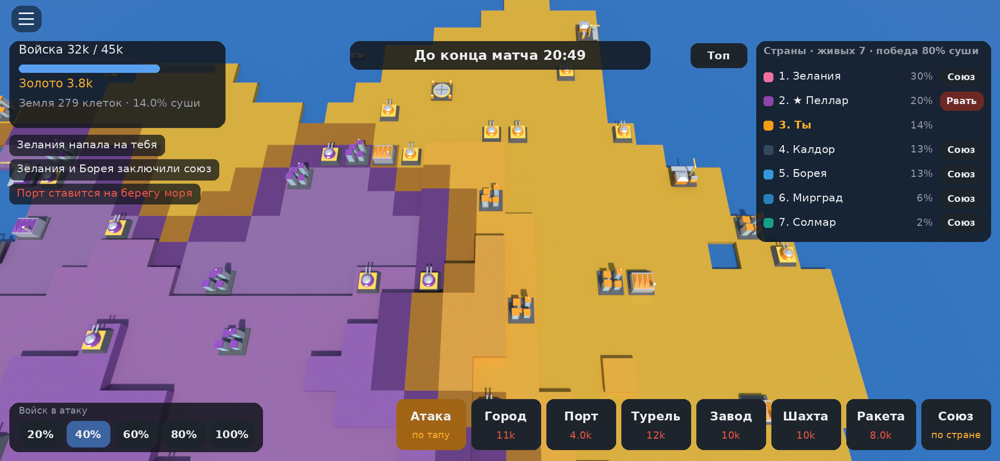

# «Фронт»: режим для Roblox

Захват карты в духе OpenFront и RoFront. Юниты и постройки сделаны в стиле Rusted Warfare,
модели созданы в Blender.

Картинку собирает `tools/`: ядро режима играет настоящий матч, Blender рисует карту и модели
с камерой клиента, сверху накладывается интерфейс. Это не скриншот из Studio: шрифты и свет
в Roblox будут немного другими.

- Карта мира из клеток: равнины, холмы, горы, моря и острова.
- В матче до 20 стран: живые игроки сервера и боты.
- **Старт.** Первые 20 секунд выбираешь место, где начнётся твоя страна. Потом 40 секунд действует щит:
  страны атаковать нельзя, можно только захватывать ничьи земли.
- **Захват.** Нажимаешь на соседнюю клетку и отправляешь в атаку выбранную долю войск (20–100%).
  Чем длиннее общая граница, тем быстрее идёт фронт. Горы и холмы захватывать дороже.
- **Десант.** Если нажать на чужой берег без общей границы, туда поплывёт транспорт.
- **Экономика.** Войска и золото растут сами.
  - Город увеличивает максимум армии.
  - Порт отправляет торговые корабли: чем дальше маршрут, тем больше золота.
  - Турель усиливает оборону вокруг себя.
  - Завод усиливает твои атаки.
  - Ракетная шахта позволяет запустить ядерный удар.
  - Повторная постройка на той же клетке повышает её уровень.
- **Союзы.** Предложить союз или разорвать его можно в таблице стран. Разрыв союза считается
  предательством, и боты не дружат с теми, кто предавал дважды.
- **Боты** расширяются, давят слабых соседей и все вместе нападают на лидера. Они строят
  и запускают ракеты, а ослабевших союзников предают.
- **Победа:** контроль над 80% суши. Если за 25 минут этого никто не добился, побеждает
  самая большая страна. Потом начинается новый раунд.

## Как запустить (нужен компьютер с Roblox Studio)

1. Установи [Roblox Studio](https://create.roblox.com/) и войди в свой аккаунт.
2. Скачай [`Front.rbxl`](https://raw.githubusercontent.com/vcrfftrk9w-afk/-/claude/blender-sword/roblox/Front.rbxl)
   (браузер сохранит его в «Загрузки») и открой двойным щелчком или через **File → Open from File…**
   В папке есть и текстовая версия `Front.rbxlx` с тем же содержимым: её удобно смотреть глазами,
   но браузер показывает её как текст вместо скачивания.
3. Нажми **Play** (F5). Появится карта с ботами. Нажми на сушу, чтобы выбрать место старта.
   Управление на компьютере такое: клик действует, перетаскивание двигает карту, колесо меняет масштаб.
   Чтобы проверить игру как на телефоне, включи **Test → Device** и выбери телефон.
   Там нажатие действует, один палец двигает карту, двумя пальцами меняется масштаб.

Игра работает сразу: пока модели из Blender не импортированы, юниты собраны из простых блоков.

## Модели из Blender

В папке `models/` лежат файлы `Tank.fbx`, `City.fbx`, `Port.fbx`, `Defense.fbx`, `Factory.fbx`,
`Silo.fbx`, `Nuke.fbx`, `TransportShip.fbx` и `TradeShip.fbx`. Как они выглядят, видно в `models/preview.png`.

1. В Studio открой **File → Import 3D** (эта кнопка есть и на вкладке Home) и выбери FBX-файлы.
2. После импорта модели появятся в Workspace. Перетащи их в **ReplicatedStorage → FrontModels**.
   Имена моделей не меняй: игра ищет их по именам `Tank`, `City`, `Port` и так далее.
3. Нажми Play: вместо блоков теперь будут модели из Blender.

Цвет страны и остальные цвета игра выставляет сама по именам деталей (`Team`, `Metal`, `Dark`,
`Hazard`, `Glass`, `Light`), поэтому настройки цвета в импортёре не важны.
Если корабли плывут кормой вперёд, поставь `Config.MODEL_YAW = 180`.

Модели можно поменять в Blender: открой `blender/make_models.py`, внеси правки и запусти
`blender -b -P blender/make_models.py`. Скрипт заново создаст FBX-файлы и картинку превью.

## Публикация

1. **File → Publish to Roblox**, затем придумай название и описание.
2. **Game Settings → Permissions**: выбери Public. В разделе **Places → Devices** отметь
   телефон, планшет и компьютер.
3. После этого игра откроется в приложении Roblox на телефоне, и в неё можно звать друзей.

## Для разработчиков

- `src/shared/Config.luau`: все числа баланса.
- `src/shared/Core.luau`: логика матча на чистом Luau, без API Roblox.
- `src/shared/Models.luau`: модели и запасные модели из блоков.
- `src/server/FrontServer.server.luau`: сервер, карта, постройки, удалённые события.
- `src/client/FrontClient.client.luau`: камера, управление, интерфейс, эффекты.
- `default.project.json`: проект для [Rojo](https://rojo.space/), если работаешь из VS Code.
- `python3 build_place.py`: пересобирает `Front.rbxlx` из `src/`; `rojo build default.project.json -o Front.rbxl` собирает бинарный `Front.rbxl`.
- `tests/run_all.sh`: тесты без Studio через [Luau CLI](https://github.com/luau-lang/luau/releases).
  Они проверяют полный матч ботов, серверный и клиентский скрипты на эмуляторе API Roblox.
